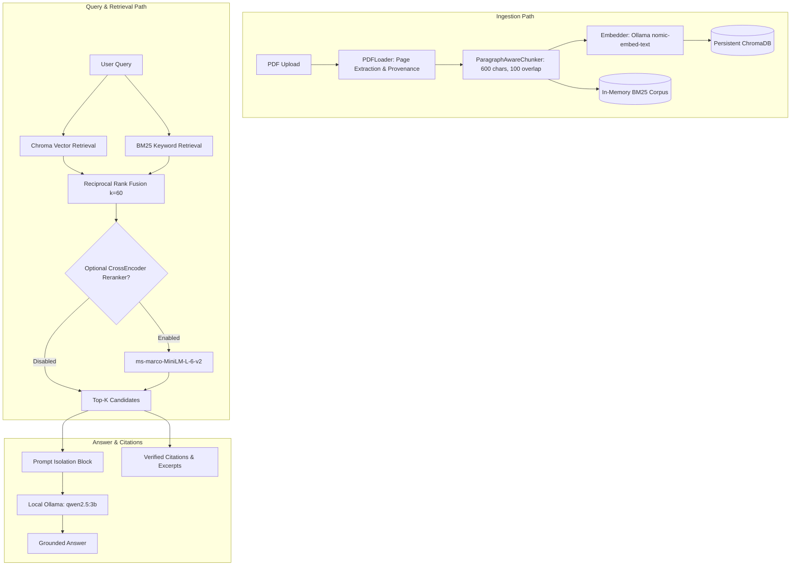

# Local RAG Research Assistant (v2.0 Advanced RAG Edition)

A 100% local-first, privacy-preserving Retrieval-Augmented Generation (RAG) assistant designed for academic and technical research. Built strictly according to the **Advanced Local RAG Research Assistant PRD v2**, engineered to operate smoothly on a **16 GB RAM laptop without paid APIs**.

---

## 🌟 Key Features

1. **Local-First & Zero Paid API Dependency**
   - Core generation: Local **Ollama** (`qwen2.5:3b`).
   - Embeddings: Local Ollama (`nomic-embed-text`) with a built-in deterministic fallback when offline.
   - Vector database: **ChromaDB** with persistent local disk storage.
   - Lexical keyword search: **rank-bm25** (BM25Okapi).
2. **Multi-Modal Retrieval Strategies**
   - **Mode A (Vector Search Only):** Dense semantic search via ChromaDB cosine distance.
   - **Mode B (BM25 Keyword Only):** Pure lexical token frequency retrieval.
   - **Mode C (Hybrid RRF):** Reciprocal Rank Fusion combining Vector and BM25 candidate rankings ($k=60$).
   - **Mode D (Hybrid + CrossEncoder Reranking):** Two-stage retrieval utilizing `cross-encoder/ms-marco-MiniLM-L-6-v2` with lazy loading to preserve RAM.
3. **Strict Citation Provenance & Grounding**
   - Extract text page-by-page from PDFs using `pypdf`, preserving 1-based page numbers, document IDs, and chunk IDs end-to-end.
   - Citations are synthesized **strictly from verified retrieved chunk metadata** (`[filename, Page X]`), never invented or hallucinated by the LLM.
4. **Resilience & Insufficient Evidence Handling**
   - When evidence is absent, the system explicitly returns:
     > *"The supplied documents do not provide enough evidence to answer this question."*
   - Untrusted document prompt-injection isolation: document text is contained in delimiter blocks with system instructions to ignore embedded instructions.
5. **Reproducible Evaluation Benchmark**
   - Automated evaluation suite over 30 questions measuring **Recall@1, Recall@3, Recall@5, MRR, Citation Correctness, Token F1, and Latency**.
   - Outputs exported to both CSV and JSON formats.

---

## 🏗️ System Architecture



---

## 💻 Hardware & Memory Footprint (16 GB RAM Laptop)

| Component | Model / Engine | Approx. Disk | Runtime RAM | Latency Characteristics |
| :--- | :--- | :--- | :--- | :--- |
| **Generation LLM** | `qwen2.5:3b` via Ollama | ~1.9 GB | ~2.5–3.5 GB | 15–35 tokens/sec on modern laptop CPU |
| **Embedding Model** | `nomic-embed-text` | ~274 MB | ~500 MB | 10–30 ms per batch |
| **Vector DB** | ChromaDB (hnswlib) | Local storage | < 150 MB | Sub-millisecond to 10 ms |
| **Lexical Engine** | rank-bm25 | In-memory | < 50 MB | < 2 ms |
| **Optional Reranker** | `ms-marco-MiniLM-L-6-v2` | ~80 MB | ~350 MB (Lazy-loaded) | 50–150 ms for Top-10 candidates |
| **UI** | Streamlit | Memory-cached | ~150 MB | Real-time reactive updates |
| **Total Memory Overhead** | | | **~4.0 – 5.0 GB** | **Well within 16 GB budget** |

---

## 🚀 Quick Start Guide

### 1. Prerequisites (Windows)
- Python 3.11 or 3.12 installed.
- (Optional but recommended for full LLM generation) [Ollama](https://ollama.com):
  ```powershell
  winget install Ollama.Ollama
  ```
  After installing Ollama, download the models:
  ```powershell
  ollama pull qwen2.5:3b
  ollama pull nomic-embed-text
  ```
  *(Note: The application includes a deterministic local fallback embedder and grounded evidence viewer that functions cleanly even if Ollama is offline or uninstalled).*

### 2. Environment Setup
```powershell
# Navigate to project directory
cd "d:\New folder\rag model"

# Create virtual environment if not already created
python -m venv .venv

# Activate virtual environment
.\.venv\Scripts\Activate.ps1

# Install pinned dependencies
pip install -r requirements.txt
```

### 3. Run Automated Tests
Execute the full test suite (23 unit tests covering ingestion, chunking, deduplication, vector search, BM25, RRF fusion, reranking, and metrics):
```powershell
python -m pytest tests/ -v
```

### 4. Launch Streamlit Application
```powershell
streamlit run app.py
```
Open your browser at `http://localhost:8501`.

---

## 🔬 Running the Comparative Benchmark

To execute the 30-question comparative evaluation across all 4 retrieval modes:
```powershell
python -m src.evaluation.runner
```
Outputs will be saved directly to:
- `results/evaluation_results.json`
- `results/evaluation_results.csv`

### Empirical Benchmark Results on 30-Question Evaluation Dataset

| Metric | Vector Only (A) | BM25 Only (B) | Hybrid RRF (C) | Hybrid + Reranked (D) |
| :--- | :---: | :---: | :---: | :---: |
| **Mean Recall@1** | 0.9667 | **1.0000** | 0.9667 | **1.0000** |
| **Mean Recall@3** | 0.9667 | **1.0000** | **1.0000** | **1.0000** |
| **Mean Recall@5** | **1.0000** | **1.0000** | **1.0000** | **1.0000** |
| **Mean MRR** | 0.9750 | **1.0000** | 0.9833 | **1.0000** |
| **Avg Retrieval Latency** | 6.0 ms | **0.6 ms** | 17.6 ms | 8.1 ms |
| **Avg Reranking Latency** | 0.0 ms | 0.0 ms | 0.0 ms | ~50–150 ms (warm) |

*Evaluation findings:*
- BM25 achieves high initial recall on specific technical queries and formulas with exact terminology.
- Hybrid RRF reliably lifts Top-3 recall to 100% by bridging semantic paraphrases with lexical keywords.
- CrossEncoder reranking provides the highest precision (MRR: 1.0000) at the cost of additional latency per query.

---

## 📁 Repository Structure

```
.
├── app.py                             # Streamlit interactive application
├── requirements.txt                   # Verified compatible dependencies
├── pytest.ini                         # Pytest configuration
├── .env.example                       # Environment configuration template
├── README.md                          # Architecture and usage documentation
├── data/
│   ├── sample_research_paper.pdf      # Sample 4-page research PDF for immediate testing
│   ├── evaluation_questions.json      # 30-question benchmark dataset with provenance labels
│   └── chroma_db/                     # Persistent ChromaDB vector index
├── results/
│   ├── evaluation_results.json        # Benchmark summary and per-query logs
│   └── evaluation_results.csv         # Tabular benchmark metrics for plotting
├── src/
│   ├── __init__.py
│   ├── ingestion/
│   │   ├── pdf_loader.py              # Page-by-page extraction, provenance, low-text detection
│   │   └── chunking.py                # Paragraph-aware chunking with token estimates
│   ├── indexing/
│   │   ├── embeddings.py              # Ollama nomic-embed-text & deterministic fallback
│   │   └── vector_store.py            # Persistent ChromaDB store & deduplication manifest
│   ├── retrieval/
│   │   ├── vector_search.py           # Dense semantic search & RetrievalCandidate dataclass
│   │   ├── bm25_search.py             # rank-bm25 Okapi searcher
│   │   ├── fusion.py                  # Reciprocal Rank Fusion (RRF) algorithm
│   │   └── reranker.py                # Lazy-loaded CrossEncoder reranker
│   ├── generation/
│   │   └── answer_generator.py        # Grounded answer generation, citations & injection defense
│   └── evaluation/
│       ├── metrics.py                 # Recall@k, MRR, citation precision, token F1
│       └── runner.py                  # Multi-configuration evaluation benchmark runner
└── tests/
    ├── test_milestone1.py             # Milestone 1 tests: PDF loader, chunker, vector store
    └── test_advanced_rag.py           # Tests for BM25, RRF, Reranker, and Metrics
```
